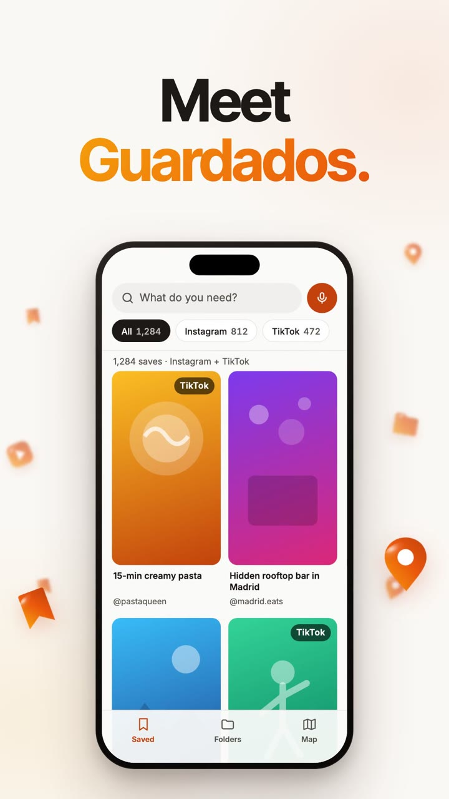

# Guardados

**Your Instagram saves and TikTok favorites in one place, searchable. No AI, no account, free — and end-to-end encrypted to your phone.**



▶️ **Watch the 1-minute demo:** https://nachosanbenito.com/guardados-app/
⬇️ **Download:** [Guardados.dmg](https://github.com/nachoie123/guardados-app/releases/latest/download/Guardados.dmg) (macOS 11+, Apple Silicon and Intel)
📱 **On your phone:** https://nachosanbenito.com/guardados

## What it does
1. **Imports both apps.** Every Instagram save and every TikTok favorite, through the official websites you log into inside the app. If the network drops, it resumes where it left off.
2. **Search like you think.** Type "quick pasta dinner" and get the reel, matched on title, caption and @creator.
3. **Sorts itself into folders.** Recipes, trips, workouts, bars, cafés… by keyword rules in Spanish and English, no AI. You can move anything by hand and your choice always wins.
4. **Puts every place on a map.** Restaurants and spots are read from the caption and located with Apple Maps (MapKit).
5. **Follows you to your phone.** Press *Conectar el móvil*, scan the QR and the same library opens at nachosanbenito.com/guardados.

The app's interface is in Spanish for now.

## Install
1. Open `Guardados.dmg` and drag **Guardados** into **Applications**.
2. The first time, macOS says it *could not verify "Guardados"*. That's normal for apps not notarized by Apple ($99/year). Click **Done**, then go to **System Settings → Privacy & Security**, scroll down and click **Open Anyway**. Only once.
3. Log in on the **Instagram** and **TikTok** windows (they're the real instagram.com and tiktok.com) and press **Importar ahora**.

## Privacy & security
- Your password is typed into Instagram's and TikTok's own pages; the app never sees or stores it. Requests run inside those windows with your session.
- Your library lives on your Mac in `~/Library/Application Support/Guardados` (folder 700, database 600) — never inside the app.
- **Phone sync is end-to-end encrypted.** The Mac encrypts everything with AES-256-GCM (Apple CryptoKit, `tools/sello.swift`) before uploading it to a Cloudflare Worker (`cloud/`). The key travels only inside the QR, in the URL fragment, which browsers never send to a server. The server stores boxes it cannot open.
- Only the control panel can talk to the Python side; the Instagram and TikTok pages can't. `tools/seguridad.py` attacks the packaged app with hostile pages and checks that no personal data or key ends up inside the `.app` (18 checks).
- Optional: paste your own Gemini key to refine folders and the map. Without it, nothing is sent to any AI.

## How it works
- **Python + [pywebview](https://pywebview.flowrl.com/)**: a panel, the Instagram and TikTok windows, and *Mis guardados* (the library) served from `127.0.0.1`.
- `importer.py` pages through saves with `fetch()` inside each site's window and validates every response; `db.py` stores them in SQLite.
- `carpetas.py` sorts posts into a folder tree with keyword rules; `sitios.py` + `tools/geo.swift` (MKLocalSearch) find places.
- `nube.py` packs and seals what changed and uploads only that.
- Packaged with PyInstaller as a universal2 app.

## Build from source
```bash
./build.sh          # tests (50) + dist/Guardados.app + security check
tools/dmg.sh        # dist/Guardados.dmg
```

## License
MIT
